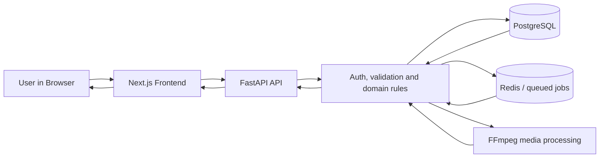

# FrameFlux — Visual Full-Stack Walkthrough

FrameFlux is a browser-based media workspace for uploading, organizing, processing, editing, previewing, sharing, and tracking media.

This walkthrough follows the same presentation style as the AutoFix visual walkthrough: it explains the product through real screens and real user flows rather than presenting a traditional developer test report.

> **Verification note:** this walkthrough is generated from the real browser + FastAPI + PostgreSQL + Redis + FFmpeg test environment. Playwright screenshots are committed by CI into `docs/testing/visuals/` so GitHub renders the evidence directly in this page. The final all-green status is only claimed after the complete browser matrix passes.

### Final verification result

**Verified:** October 25, 2026 — Full-Stack Visual E2E run **#40174379068** completed successfully, with **6/6 Playwright tests passing**. The tested application commit was **7cfc40987e63dde6741a9d9c7991f4470ae9cef9**, and the same commit passed Frontend Production Checks (lint + production build). The workflow completed successfully through backend stack startup, PostgreSQL/Redis-backed backend tests, real FFmpeg fixture generation, frontend startup, browser walkthrough, evidence upload, screenshot commit, and shutdown.

The six browser scenarios were:

1. Public/authentication/workspace inventory/account settings
2. Project CRUD, folders and real resumable media upload
3. Media processing, editor, thumbnails, previews, versions and sharing
4. Feature capability sweep with real API data and UI read-back
5. Comprehensive authenticated capability matrix and lifecycle read-back
6. Real login/logout and final database cleanup evidence

The evidence in this document comes from the repository's Full-Stack Visual E2E workflow. The test environment starts the real FastAPI backend, PostgreSQL, Redis, FFmpeg, and Next.js frontend, performs browser actions, verifies HTTP responses, and reads the resulting records back from the API/database-backed application.

## The product at a glance

**Public home → account creation → authentication → dashboard → projects → folders → media upload → media detail → editing/tools → processing → previews/thumbnails → subtitles/audio → favorites/search/history/jobs → sharing → batch/quick actions → presets/workflows → storage/notifications → logout**

The application is deliberately tested as one system:

---

## 1. Entering FrameFlux

### Public homepage

The first screen is the public entry point. The browser loads the application from the real Next.js server; no mock landing data is required to reach the application.

### Creating a real account

The browser submits a real registration request to `POST /auth/signup`. The API creates the user and immediately establishes the authenticated application state. The same session is then used against `/auth/me`.

The workflow verifies the response rather than trusting the visual transition alone:

- browser submits the signup form
- FastAPI creates the user
- PostgreSQL-backed authentication state is returned
- browser receives the session token
- `/auth/me` confirms the signed-in account

### Dashboard after authentication

The dashboard is a live application surface. Subsequent navigation is performed with the authenticated session rather than static screenshots.

### Password recovery

The test performs the password recovery API flow against the real backend. In the disposable CI environment, the one-time reset token is read from the real Redis instance and then submitted to the actual `/auth/reset-password` endpoint. The new password is used for a real login and then restored to the original test password.

This proves the reset flow is not a fake success message: the credential is actually changed and accepted by the authentication system.

---

## 2. The workspace

Every major workspace page is opened through the real authenticated frontend. The screenshots below are captured from the live UI after its API requests complete.

### Projects

### Media library

### Batch processing

### Favorites

### Quick actions

### Search

### Workflows

### Presets

### Notifications

### Storage

### History

### Jobs

### Settings

### Help

---

## 3. Real project and media lifecycle

### Create a project

The browser creates a project with a real API request. The test then queries the projects API and locates the newly created project by its generated name.

**What this proves:** the card visible in the browser corresponds to a persisted project record.

### Open project details

### Create a folder

The test explicitly opens the project's **Folders** tab, creates a folder, and reads it back through the folders API.

### Upload real media

The browser uploads an actual MP4 fixture. The resulting media ID is extracted from the application and then read through the backend. The read-back confirms the stored filename is `sample.mp4`.

### Upload multiple media types

The same environment uploads a second MP4, a WAV file, and a JPEG. These records are used later by the audio, image, preview, thumbnail, and processing tests.

### Update a project

The updated project name is verified with a fresh API GET after the UI action completes.

---

## 4. Media detail and editor

### Media overview

The media detail page brings together the current media record, processing state, editor, versions, sharing, and metadata capabilities.

### Processing completion

The test triggers the real processing endpoint, then polls the media status until it reaches `completed`. This is a genuine worker/Redis/FFmpeg flow rather than a front-end state change.

### Processing tab

### Tools tab

### Versions tab

### Sharing tab

### Metadata tab

### Transform editor

The video editor uses the actual tool controls rendered by the frontend. The test clicks the Transform tool, asserts that the transform panel appears, and then executes **Apply Transform**.

### Overlay editor

The same editor exposes overlay controls. The test verifies that the overlay panel can be reached through the real UI before the underlying API capability is exercised.

### Tools workspace

---

## 5. Thumbnails, previews, subtitles, audio and image processing

The application has separate feature areas for binary media operations. Those were tested against the actual uploaded media records rather than synthetic IDs.

### Thumbnail and preview operations

The workflow verifies:

- video preview generation
- GIF preview generation
- single-frame thumbnails
- thumbnail sets
- thumbnail selection
- thumbnail cropping
- image conversion
- image compression

The same media ID is carried through these requests so each result belongs to the persisted media record.

### Subtitle workflow

A real SRT fixture is uploaded. The workflow then tests:

- subtitle upload
- track listing
- text editing
- subtitle burn-in
- subtitle muxing
- subtitle timestamp sync

The mux path was exercised against the real FFmpeg binary and was hardened to use explicit stream mapping for MP4 output.

### Audio workflow

The actual WAV upload is used for:

- audio conversion
- audio extraction
- volume/fade operations
- audio editing
- batch audio extraction
- replacing audio
- audio-to-video conversion
- audio/video synchronization

These are not simulated responses. The test waits for actual API responses and validates the HTTP contract and downstream media handling.

---

## 6. Sharing

### Create a share link

The media sharing UI creates a real share record. The workflow reads it back from the sharing API.

The database schema was also corrected during this validation pass: the `share_links` table now contains the `view_count` and `allowed_domains` columns used by the application model.

### Disable a share

The test disables a share and then verifies that the public lookup returns `404`. That behavior is intentional: disabled links are not exposed as active public shares.

### Public player and embed

The capability matrix creates a fresh share token specifically for public-link checks and verifies both:

- the public share player endpoint
- the embed endpoint

A fresh token is used so the earlier disabled-share test cannot contaminate the public-share check.

---

## 7. Favorites, search, history and jobs

### Favorite read-back

A real favorite is created through the API using the real media ID. The browser then reloads the favorites page and verifies the saved record is rendered.

### Search

### History

### Jobs

The jobs and history screens are validated against authenticated API reads, not static placeholders.

---

## 8. Comparisons, batch processing and quick actions

### Comparisons

Two real media records are compared through the comparison endpoint.

### Batch processing

The test submits a real batch processing request containing real uploaded media IDs, then reads its status.

### Quick actions

Quick actions are discovered from the backend and then executed against a real media record.

---

## 9. Presets and workflows

### Create a preset

Preset creation is performed in the live UI and confirmed with a fresh API list/read.

The workflow also exercises preset update and delete operations through the authenticated API matrix.

### Workflow lifecycle

The capability matrix covers the workflow CRUD lifecycle:

**create → list → get → update → run → delete**

A workflow run uses a real media record and therefore exercises the application's queue/job path rather than only persisting a configuration object.

---

## 10. Storage, notifications and account settings

### Storage

The workflow verifies storage totals, by-type usage, and by-folder usage against the authenticated API.

### Notifications

A notification is created and then read back from the notification list. The suite also verifies unread-count, mark-read, and read-all operations.

### Profile and preferences

The profile name is changed in Settings and then fetched with `GET /auth/me`. This demonstrates that the settings form updates the actual authenticated user record.

---

## 11. Media versions and binary downloads

The matrix exercises media version listing plus version get/download/restore when version records are available.

It also verifies original and processed media download endpoints and the media-file endpoint using real stored files.

---

## 12. Resumable uploads

The upload subsystem is validated as a real lifecycle rather than a single POST:

**init → chunk → retry → progress → pause → resume → finalize → final media read-back → cleanup**

The test uploads the bytes of the real `sample.mp4` fixture to the resumable endpoint, reads progress, pauses and resumes the transfer, finalizes it, verifies the resulting media record, and finally deletes the disposable record.

---

## 13. Error handling and important edge cases

FrameFlux is not considered tested only because happy paths work. The suite also checks important negative paths:

### Invalid media operation

A deliberately invalid media edit is expected to return a validation/client error (`400` or `422`) instead of silently succeeding.

### Missing project

A request for a non-existent project ID is expected to return `404`.

### Disabled public share

Once a share is disabled, the public token lookup returns `404`.

### Resumable upload controls

Pause, resume, retry and finalization are all exercised as real state transitions.

### Authentication boundary

The final browser flow verifies that logout redirects to the login screen and removes the access token from browser storage.

---

## 14. Complete feature coverage map

The repository was inventoried before execution. The backend contains 33 feature route modules and the frontend contains the authenticated pages listed below. Public health probes and the live UI-preferences endpoints are also included in the authenticated capability matrix.

| Feature area | Browser surface | API / backend coverage |
| --- | --- | --- |
| Authentication | signup, login, reset, settings, logout | signup, login, me, password reset/change, logout |
| Dashboard | dashboard | overview + recent processing |
| Projects | projects, project detail | create/list/get/update/delete, status, media, folders/history/workflows |
| Media library | media, media detail | upload, read, update, processing, downloads, versions |
| Video editing | editor/tools | transform, overlay and media operation endpoints |
| Audio | media/audio controls | convert, extract, edit, volume/fades, replace, sync, batch extract, audio-to-video |
| Images | image media tools | convert, compress |
| Thumbnails | preview/tools | thumbnail, sets, select, crop |
| GIF / preview | media tools | GIF and video preview endpoints |
| Subtitles | media subtitle controls | upload, tracks, edit, burn, mux, sync |
| Batch | batch page | batch process/upload/status/download paths |
| Comparisons | comparisons | real media comparison |
| Favorites | favorites | create/list/delete |
| Search | search | authenticated search |
| History | history | create/read |
| Jobs | jobs | job list/status |
| Notifications | notifications | create/list/unread/read/read-all |
| Presets | presets | create/list/update/delete |
| Workflows | workflows | create/list/get/update/run/delete |
| Sharing | sharing tab | create/list/disable/delete/player/embed/stream |
| Storage | storage | usage, by type, by folder |
| Settings | settings | profile and preferences |
| Effects | editor/API capability | list/apply/remove |
| Transcoding | processing/API capability | transcode/convert/compress |
| Streaming/UI helpers | backend capability | endpoint-level coverage |
| Users | authentication/profile | authenticated account state |

---

## 15. What was actually verified

The full-stack workflow is intentionally stricter than a screenshot demo.

For each tested browser action, the workflow attempts to verify the complete path:

**User action → frontend request → HTTP response → backend processing → database/queue/media state → fresh read-back → UI evidence**

The CI environment used:

- the real FrameFlux frontend repository
- the real FrameFlux backend repository
- PostgreSQL
- Redis
- FFmpeg
- real generated MP4/WAV/JPG/SRT fixtures
- Playwright Chromium
- the actual API endpoints
- the actual authenticated session flow

No mock API responses or fake frontend success states are used by the walkthrough.

---

## 16. Final evidence

The screenshots are intended to be read together with the explanations above: the images show the real product, while the accompanying descriptions explain what backend/API/database evidence was checked for each flow.

### Test implementation in this repository

The automated evidence is kept alongside the product:

- `tests/e2e/full-stack.spec.ts`
- `playwright/fullstack-global-setup.ts`
- `playwright.config.ts`
- `.github/workflows/fullstack-e2e.yml`
- `docs/testing/visuals/`

This keeps the walkthrough reproducible for future contributors and reviewers instead of making the documentation dependent on a local machine.
